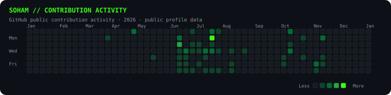

<!-- Profile README for github.com/Sohamdp10-code -->

<table>
  <tr>
    <td valign="top"></td>
    <td valign="top"></td>
  </tr>
</table>

Hi, I'm Soham, a Computer Science & Engineering (AI & ML) student. I focus on building reliable software, strengthening my problem-solving through data structures and algorithms, and documenting my work openly.
Explore my repositories to see what I'm building.

## `~/stack`

  
  
  
  
  
  
  
  
  
  

## `~/activity`

  

  

> GitHub's own contributions calendar is the source of truth. The activity graph and stats cards are optional third-party images built from public GitHub data and may be unavailable at times.

## `~/daily-log`

The [activity log](./activity-log.md) keeps a dated record of newly accepted LeetCode solutions. GitHub Actions checks the public LeetCode profile hourly and logs newly accepted submissions. Separate scheduled workflows also run daily to append a maintenance line to the log and refresh the timestamp below, so some bot commits are routine upkeep rather than new solutions.

<!-- AUTO-UPDATE:START -->
🕒 Last auto-updated: 2026-11-12 23:48 UTC
<!-- AUTO-UPDATE:END -->

## `~/connect`

Find my work in the repositories tab, or reach me by email:

  

