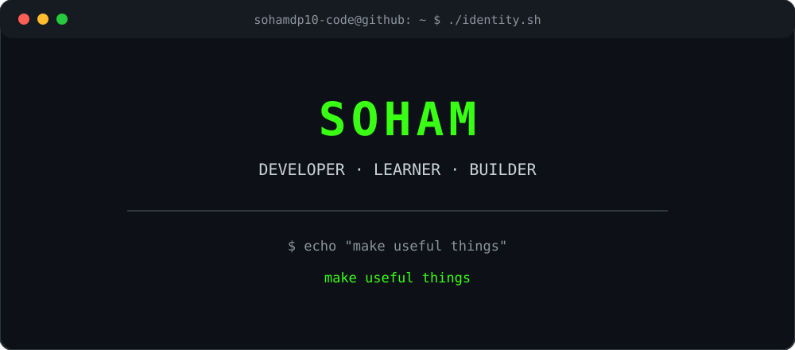

<!-- Profile README for github.com/Sohamdp10-code -->

<div align="center">

<h3><code>sohamdp10-code@github ~ $ whoami</code></h3>

<table>
  <tr>
    <td valign="top"></td>
    <td valign="top"></td>
  </tr>
</table>

</div>

```bash
$ cat about.txt
Hi — I’m Soham. I use GitHub to learn, build, and document useful work.
This profile is a work in progress; the best place to see what I am doing
is in my repositories and activity log.
```

## `~/stack`

<p>
  
  
  <!-- Add only technologies you actually use below. -->
</p>

<div align="center">

<h3><code>sohamdp10-code@github ~ $ ./contributions.sh</code></h3>


</div>

<div align="center">

<h3><code>sohamdp10-code@github ~ $ ./leetcode.sh --heatmap</code></h3>

<a href="https://leetcode.com/u/Sohamdp10/"></a>

</div>

## `~/activity`

```text
$ ./contributions.sh --graph
The live graph below is supplied by GitHub.
```

<p align="center">
  
</p>

<p align="center">
  
</p>

> GitHub's own contributions calendar is the source of truth. The activity graph and stats cards are optional third-party images built from public GitHub data and may be unavailable at times.

## `~/daily-log`

This repository keeps a dated record of newly accepted LeetCode solutions. The scheduled workflow checks the public LeetCode profile hourly and commits only when it finds a new accepted submission; it does not create empty commits or claim work that was not done.

```bash
$ tail -n 1 activity-log.md
<!-- New entries are written by the LeetCode activity sync workflow. -->
```

## `~/connect`

```text
$ echo "Find my work in the repositories tab."
Find my work in the repositories tab.
```
